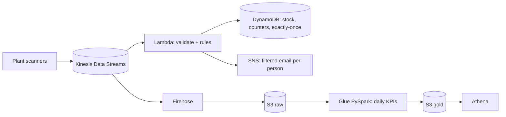

# Catch scrap and stock-outs on the factory floor in seconds

A streaming + batch data pipeline on AWS that tells a plant **where it is losing money to scrapped parts, which supplier or station is causing it, and whether a line is about to stop because a part is running out.**


  

> 🚧 **Work in progress.** This repository is built in small, reviewed levels; the table below shows where it stands. Each level is a separate set of commits.

## Progress

| Level | What | Status |
|---|---|---|
| 0 | Business case, KPIs, design, cost estimate (`docs/spec.md`, `docs/architecture.md`, `docs/kpi-dictionary.md`, `docs/decisions.md`) | ✅ Done |
| 1 | Plant data generator: 2 plants, 11 parts, 4 suppliers, 7 days of history with three planted incidents | ✅ Done |
| 2 | Real-time alert logic: event validation, KPI math, **statistical process control** reject-rate rule | ✅ Done |
| 3 | Exactly-once state in DynamoDB (one transaction per event), SNS alerts, Lambda handler | ✅ Done |
| 4 | Terraform: Kinesis, Lambda, DynamoDB, SNS with per-person filtered subscriptions | ✅ Done |
| 5 | Firehose landing to S3 + Glue (PySpark) daily KPIs: validation with quarantine, deduplication, one gold table per KPI, record reconciliation | ✅ Done |
| 6 | Athena KPI rollups (`GROUP BY ROLLUP`) and charts | ⏳ Next |
| 7 | Real deploy with evidence, cost report, teardown | ⏳ |

## 1. The business problem

In an assembly plant, two things quietly cost money every day:

- **Scrap.** Parts fail inspection and are thrown away. It is usually reported once a month, so a defective supplier lot can be consumed for weeks before anyone connects the rejects to it.
- **Stock-outs.** A part runs out, the line stops, and every hour stopped costs thousands of dollars. Today the shortage is discovered when the bin is empty.

**Who uses it:** Purchasing (expedite an order before a part runs out) · Quality (inspect a station or quarantine a supplier lot) · Plant manager (lines behind plan) · Plant controller (scrap cost, and charging supplier defects back to the supplier)

## 2. KPIs

| KPI | Formula | Hierarchy | Alert | Frequency |
|---|---|---|---|---|
| **Reject rate %** | rejected ÷ (consumed + rejected) | Plant → Line → Station → Part · Supplier → Part → Lot | Station-hour above its 3σ **p-chart control limit** (never below 3%, ≥ 4 rejects) → email Quality | Real time + daily |
| **Stock coverage (days)** | units on hand ÷ planned daily usage | Plant → Part → Supplier | < 1 day → email Purchasing | Real time |
| **Throughput vs plan %** | produced ÷ planned units | Plant → Line → Shift → Hour | Report only | Daily |
| **Scrap cost ($)** | rejected units × unit cost | Plant → Supplier → Part · Plant → Line → Station | Report only (supplier defects = chargeback candidates) | Daily |

Full definitions: [docs/kpi-dictionary.md](docs/kpi-dictionary.md)

## 3. Architecture



Details, data flow and storage layout: [docs/architecture.md](docs/architecture.md) · why each choice: [docs/decisions.md](docs/decisions.md)

## 4. Lessons learned so far

1. **A fixed 3% alert threshold produced 64% false alarms** on a realistic session (22 alerts, 14 false), because stations handle very different volumes. A **p-chart control limit** that adapts to volume raises 7 alerts, all 7 on the stations using the defective lot.
2. **Testing against a simulated AWS API (moto) caught a bug unit tests missed:** `consumed` is a DynamoDB reserved word. Fixed before any deploy.
3. **On Apple Silicon, check the toolchain's CPU architecture:** an Intel Terraform under Rosetta timed out loading the AWS provider. The native arm64 build fixed it, and `terraform validate` then caught two real type errors.

4. **A record-count reconciliation test found a corrupted scan that rule-by-rule validation let through:** 55 corrupted scans, 54 quarantined. A finished-unit scan with a made-up part code was being counted as production. The job now proves `raw = curated + duplicates + quarantined` for every day before writing (53,126 = 52,562 + 509 + 55).

All entries, with numbers: [docs/lessons-learned.md](docs/lessons-learned.md)

## 5. Run it

Setup, every configuration file and the run order: [docs/configuration.md](docs/configuration.md)

```bash
make install && make test   # unit, simulated-AWS (moto) and local Spark tests, no AWS account needed
make generate               # 7 days of simulated plant history into data/generated/
make kpis-local             # run the Glue (PySpark) KPI job on it with a local Spark, no AWS
```

**Estimated cost of a full demo run:** ≈ $0.15 (see `docs/spec.md`, section 5).

## Repository layout

```
config/            settings.yaml (every tunable value) · master_data.yaml · subscribers.example.yaml
docs/              spec, architecture, KPI dictionary, decisions, lessons learned, configuration, coding standards
infra/terraform/   one numbered file per pipeline stage
src/
  common/          shared contract (schema), settings, config, logging, AWS clients
  generators/      plant simulator: history backfill and live producer
  lambdas/         realtime_alerts: parsing · rules · state · notifier · handler
  glue_jobs/       daily_kpis (extract → transform → reconcile → load) · transforms (pure PySpark)
scripts/           seed_stock, kpis_local, leftovers, cost
tests/             unit tests and moto-backed integration tests
```

Code standards: modular, typed, commented at every step. See [docs/CODING_STANDARDS.md](docs/CODING_STANDARDS.md).
