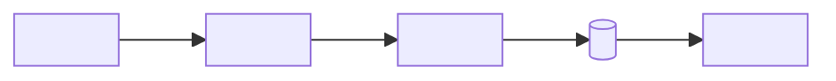
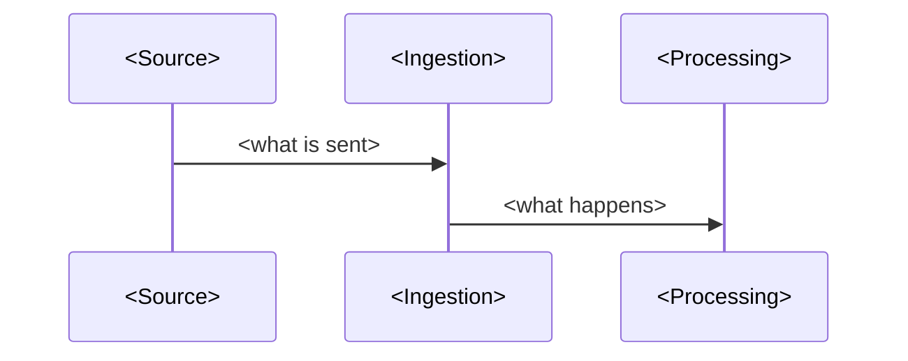

<!--
TEMPLATE: replace every <...> and delete these comments.
Order matters: a non-technical reader should understand sections 1–4 without reading code.
-->

# <Business outcome in plain words, e.g. "Catch scrap and stock-outs on the factory floor in seconds">

<One sentence: what this pipeline measures, for whom, and how fast.>


  


## 1. The business problem
<One paragraph for any industry: what goes wrong today, what it costs, who decides, what decision this enables.>

**Who uses it:** <role 1> · <role 2> · <role 3>

## 2. KPIs
| KPI | Formula | Why it matters | Threshold / alert | Frequency |
|---|---|---|---|---|
| <KPI 1> | <a / b> | <impact> | <e.g. > 2% → SNS> | <real time / hourly / daily> |
| <KPI 2> | | | | |
| <KPI 3> | | | | |


Full definitions: [docs/kpi-dictionary.md](docs/kpi-dictionary.md)

## 3. What the data shows
<Real results from the deployed run. 3 findings, each with a number and the decision it drives.>

1. **<Finding>:** <number> → <decision>
2. **<Finding>:** <number> → <decision>
3. **<Finding>:** <number> → <decision>


## 4. Architecture


**Data flow:** how one record travels, step by step.


## 5. Why each service
| Service | Role here | Why this one (and not the alternative) |
|---|---|---|
| <Service> | <role> | <reason, e.g. "Firehose instead of a custom consumer: no code, built-in Parquet conversion"> |

## 6. Alerts and schedule
| Alert / job | Rule or schedule | Channel | Owner |
|---|---|---|---|
| <Low stock> | <stock_left < safety stock> | SNS email | <Purchasing> |
| <Nightly ETL> | `cron(0 6 * * ? *)` | Glue trigger | — |

## 7. Data layers
| Layer | Location | Grain | Written by |
|---|---|---|---|
| Raw | `s3://…/raw/` | one row per event, as received | <Firehose / upload> |
| Curated | `s3://…/curated/` | <grain> | <Glue job> |
| Gold | `s3://…/gold/` | <KPI grain> | <job> |

## 8. Engineering practices
- **Idempotency / duplicates:** <how>
- **Data quality:** <checks and what happens on failure>
- **Security:** least-privilege IAM role per component, encryption at rest (SSE), TLS-only bucket policy
- **Monitoring:** <CloudWatch alarms>
- **CI/CD:** <what runs on every push>
- **Cost:** see below
- **Code standards:** modular, typed, commented at every step — see [docs/CODING_STANDARDS.md](docs/CODING_STANDARDS.md)

## 9. Run it
Full setup, every configuration file and how to change it: [docs/configuration.md](docs/configuration.md).

```bash
make install && make test      # local, no AWS
make deploy                    # creates the stack (see cost below)
make demo                      # sends data / runs the jobs
make destroy && make leftovers # tears everything down and checks nothing billable is left
```
**Estimated cost:** $<x.xx> for a <n>-hour run. **Actual cost:** $<x.xx> (Cost Explorer, tag `Project=<repo>`).

## 10. Certification mapping
| Exam | Domain | Where in this repo |
|---|---|---|
| AWS Data Engineer – Associate | <Ingestion and transformation / Store / Operations / Security and governance> | <file> |
| AWS AI Practitioner | <domain, if any> | <file> |

## 11. Lessons learned
<Decisions that changed because of evidence while building: what we assumed, what the data showed, what we changed, the measured result. Full entries in [docs/lessons-learned.md](docs/lessons-learned.md).>

- **<Lesson>:** <assumption> → <evidence with numbers> → <change> → <result with numbers>

## 12. What I'd do next
- <production improvement 1>
- <production improvement 2>

## Repository layout
```
docs/              spec, architecture, KPI dictionary, decisions, lessons learned, configuration, runbook, coding standards, images
infra/terraform/   one numbered file per pipeline stage (0_main.tf first)
src/               common (config, logging, AWS clients), generators, lambdas, glue_jobs
sql/               one query per KPI
tests/             unit tests (no AWS needed)
scripts/           leftovers and cost checks
```
