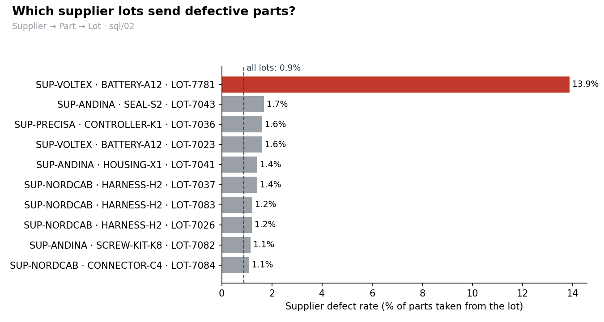
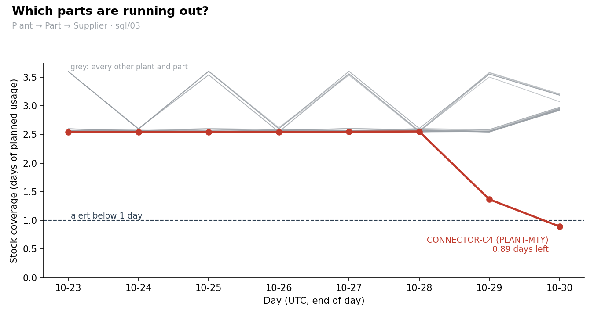
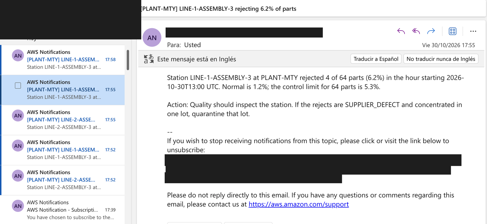
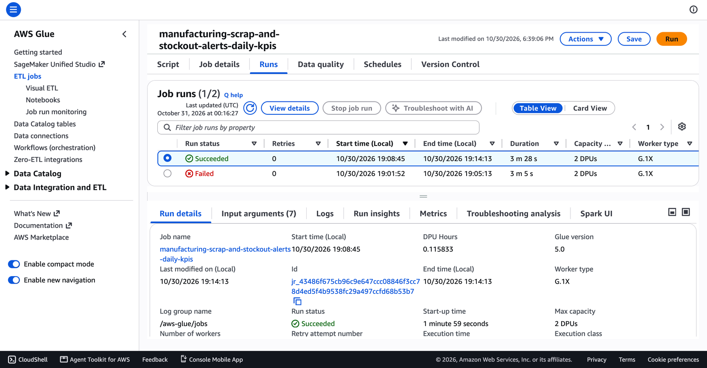
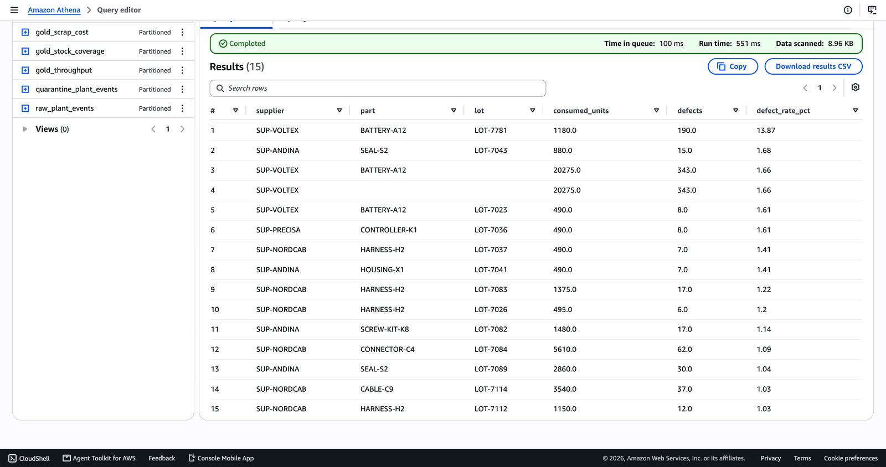
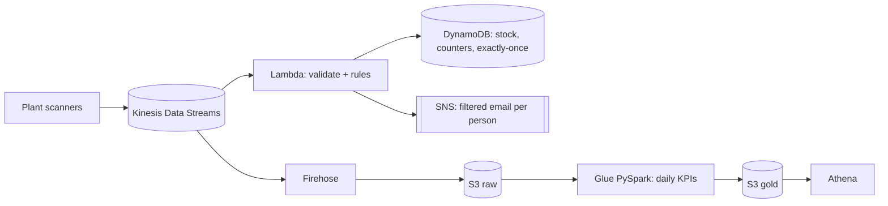

# Catch scrap and stock-outs on the factory floor in seconds

A streaming + batch data pipeline on AWS that tells a plant **where it is losing money to scrapped parts, which supplier or station is causing it, and whether a line is about to stop because a part is running out.**


  

> ✅ **Deployed for real on AWS, then destroyed.** The pipeline ran with 41 resources for 42 minutes. Every step is documented with redacted CLI output and console screenshots, and every resource was verified deleted. The whole build, level by level, is in [docs/project-story.md](docs/project-story.md).

## Progress

| Level | What | Status |
|---|---|---|
| 0 | Business case, KPIs, design, cost estimate (`docs/spec.md`, `docs/architecture.md`, `docs/kpi-dictionary.md`, `docs/decisions.md`) | ✅ Done |
| 1 | Plant data generator: 2 plants, 11 parts, 4 suppliers, 7 days of history with three planted incidents | ✅ Done |
| 2 | Real-time alert logic: event validation, KPI math, **statistical process control** reject-rate rule | ✅ Done |
| 3 | Exactly-once state in DynamoDB (one transaction per event), SNS alerts, Lambda handler | ✅ Done |
| 4 | Terraform: Kinesis, Lambda, DynamoDB, SNS with per-person filtered subscriptions | ✅ Done |
| 5 | Firehose landing to S3 + Glue (PySpark) daily KPIs: validation with quarantine, deduplication, one gold table per KPI, record reconciliation | ✅ Done |
| 6 | Athena tables (partition projection, 1 GB scan cap), six KPI queries with `GROUP BY ROLLUP`, charts from the results (same SQL tested locally on Spark) | ✅ Done |
| 7 | Real deploy with evidence, two fixes found by it, teardown verified ([deploy log](docs/evidence/deploy-log.md)). Actual cost from Cost Explorer pending (it lags ~24 h). | ✅ Done |

## 1. The business problem

In an assembly plant, two things quietly cost money every day:

- **Scrap.** Parts fail inspection and are thrown away. It is usually reported once a month, so a defective supplier lot can be consumed for weeks before anyone connects the rejects to it.
- **Stock-outs.** A part runs out, the line stops, and every hour stopped costs thousands of dollars. Today the shortage is discovered when the bin is empty.

**Who uses it:** Purchasing (expedite an order before a part runs out) · Quality (inspect a station or quarantine a supplier lot) · Plant manager (lines behind plan) · Plant controller (scrap cost, and charging supplier defects back to the supplier)

## 2. KPIs

| KPI | Formula | Hierarchy | Alert | Frequency |
|---|---|---|---|---|
| **Reject rate %** | rejected ÷ (consumed + rejected) | Plant → Line → Station → Part · Supplier → Part → Lot | Station-hour above its 3σ **p-chart control limit** (never below 3%, ≥ 4 rejects) → email Quality | Real time + daily |
| **Stock coverage (days)** | units on hand ÷ planned daily usage | Plant → Part → Supplier | < 1 day → email Purchasing | Real time |
| **Throughput vs plan %** | produced ÷ planned units | Plant → Line → Shift → Hour | Report only | Daily |
| **Scrap cost ($)** | rejected units × unit cost | Plant → Supplier → Part · Plant → Line → Station | Report only (supplier defects = chargeback candidates) | Daily |

Full definitions: [docs/kpi-dictionary.md](docs/kpi-dictionary.md)

## 3. What the data shows (real AWS run)

| Who | Finding | Action |
|---|---|---|
| Quality | **LOT-7781** (SUP-VOLTEX batteries) has a **13.87%** supplier defect rate. Every other lot is below 1.7%. | Quarantine the lot and claim it from the supplier |
| Purchasing | **CONNECTOR-C4 in Monterrey: 0.89 days** of stock left. Every other part has more than 2.5 days. | Expedite the next delivery |
| Plant manager | **LINE-3, night shift: 89.1%** of plan. Every other line and shift is at 100%. (These are the same data recomputed after the fix in lesson 7.) | Review night staffing on LINE-3 |
| Plant controller | **$239k** of scrap, of which **$169k (71%) is recoverable**. SUP-PRECISA costs the most in dollars ($132k) at normal defect rates, because its parts are expensive. | File the chargebacks. Rate and dollars point to different suppliers. |




More charts: [throughput vs plan](docs/images/throughput_vs_plan.png) · [scrap cost by supplier](docs/images/scrap_cost_by_supplier.png) · query results as CSV: [docs/images/results/](docs/images/results/)

### Proof it ran
| | |
|---|---|
| Real-time path | 1,011 live scans, **8 email alerts** (exactly the ones the tests predicted, 0 false), 104 Lambda invocations, **0 errors**, empty dead-letter queue |
| Batch path | Glue run succeeded in 3 min 28 s. **54,137 raw = 53,541 curated + 537 duplicates + 59 quarantined.** Six Athena queries scanned 43 KB in total. |
| Teardown | `41 destroyed`, empty Terraform state, `make leftovers` → **✅ Nothing billable left.** |
| Evidence | [deploy log](docs/evidence/deploy-log.md) · [CLI output per phase](docs/evidence/) · [console screenshots](docs/images/console/) |

**Screenshots from the real run** (cropped so no account details appear):

| A real alert, seconds after the scans | The batch job: failed, fixed, succeeded | One ROLLUP query, every level |
|---|---|---|
|  |  |  |

All 22 screenshots, explained step by step: **[docs/project-story.md](docs/project-story.md)** · raw files: [docs/images/console/](docs/images/console/)

## 4. Architecture



Details, data flow and storage layout: [docs/architecture.md](docs/architecture.md) · why each choice: [docs/decisions.md](docs/decisions.md)

## 5. Lessons learned

1. **A fixed 3% alert threshold produced 64% false alarms** on a realistic session (22 alerts, 14 false), because stations handle very different volumes. A **p-chart control limit** that adapts to volume raises 7 alerts, all 7 on the stations using the defective lot.
2. **Testing against a simulated AWS API (moto) caught a bug unit tests missed:** `consumed` is a DynamoDB reserved word. Fixed before any deploy.
3. **On Apple Silicon, check the toolchain's CPU architecture:** an Intel Terraform under Rosetta timed out loading the AWS provider. The native arm64 build fixed it, and `terraform validate` then caught two real type errors.

4. **A record-count reconciliation test found a corrupted scan that rule-by-rule validation let through:** 55 corrupted scans, 54 quarantined. A finished-unit scan with a made-up part code was being counted as production. The job now proves `raw = curated + duplicates + quarantined` for every day before writing (53,126 = 52,562 + 509 + 55).
5. **A local test engine must read data exactly like the real one:** Spark guessed the `dt` partition was a date; Athena declares it as text. Making the local run just as strict lets the same six SQL files run unchanged on both engines, tested before any query is paid for.
6. **The first real Glue run failed on a permission no local test can exercise:** Glue writes `curated_$folder$` marker objects outside the allowed prefixes. The policy was extended to exactly those objects, and the second run succeeded. Nothing half-written reached the lake, because the job writes only after its reconciliation passes.
7. **"No data" is not "zero":** a 6-hour gap with no scans made every night shift look 10% behind plan. Now an hour is compared with the plan only if the plant sent data in it. Same data, corrected result: only the planted LINE-3 incident remains.

All entries, with numbers: [docs/lessons-learned.md](docs/lessons-learned.md)

## 6. Run it

Setup, every configuration file and the run order: [docs/configuration.md](docs/configuration.md)

**Locally, no AWS account needed:**
```bash
make install && make test   # unit, simulated-AWS (moto) and local Spark tests
make generate               # 7 days of simulated plant history into data/generated/
make kpis-local             # run the Glue (PySpark) KPI job on it with a local Spark
make charts-local           # run the sql/ KPI queries on the result and draw the charts
```

**On AWS, from scratch** (≈ $0.15, about 45 minutes, everything deleted at the end):
1. Get an AWS account. Turn on MFA for the root user and create a budget alert in Billing → Budgets.
2. Create a working identity: IAM Identity Center (`aws configure sso`, then `aws sso login`), or an IAM user with an access key (`aws configure`). Check it with `aws sts get-caller-identity`.
3. Install the AWS CLI v2, Terraform ≥ 1.6 (native arm64 on Apple Silicon), Python ≥ 3.10 and Java 17.
4. `cp config/subscribers.example.yaml config/subscribers.yaml` and put in the emails that should receive alerts.
5. Run in order: `make deploy` → confirm the subscription emails → `make seed` → `make upload-history` → `make stream` → `make kpis` → `make charts`.
6. Tear down: `make destroy` → `make clean-glue-logs` → `make leftovers` (it must print `✅ Nothing billable left.`).

The step-by-step record of a real run is [docs/evidence/deploy-log.md](docs/evidence/deploy-log.md).

## Repository layout

```
config/            settings.yaml (every tunable value) · master_data.yaml · subscribers.example.yaml
docs/              spec, architecture, KPI dictionary, decisions, lessons learned, configuration, coding standards
infra/terraform/   one numbered file per pipeline stage
sql/               one query per business question (GROUP BY ROLLUP), runs on Athena and Spark
src/
  common/          shared contract (schema), settings, config, logging, AWS clients
  generators/      plant simulator: history backfill and live producer
  lambdas/         realtime_alerts: parsing · rules · state · notifier · handler
  glue_jobs/       daily_kpis (extract → transform → reconcile → load) · transforms (pure PySpark)
  analytics/       run sql/ on Athena or local Spark · draw the README charts
scripts/           seed_stock, kpis_local, make_charts, leftovers, cost
tests/             unit tests and moto-backed integration tests
```

Code standards: modular, typed, commented at every step. See [docs/CODING_STANDARDS.md](docs/CODING_STANDARDS.md).
