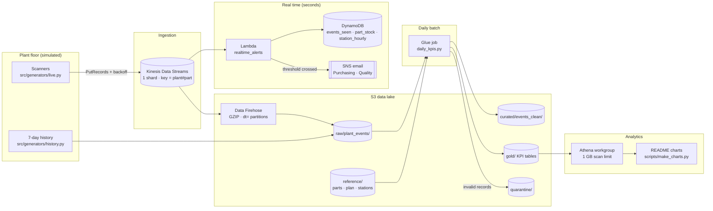
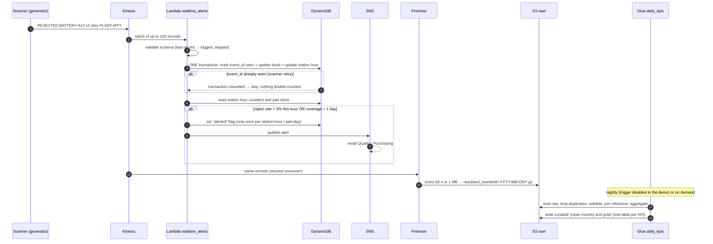

# Architecture

## 1. The big picture

Three speeds, one source of events:

| Speed | Question it answers | Path |
|---|---|---|
| **Seconds** | "Are we about to run out of a part?" "Is a station rejecting too much right now?" | Kinesis → Lambda → DynamoDB → SNS email |
| **~1 minute** | "Keep every scan, exactly as it happened" | Kinesis → Firehose → S3 `raw/` |
| **Daily** | "Where did we lose money, and who caused it?" | S3 `raw/` → Glue (PySpark) → S3 `curated/` + `gold/` → Athena |



## 2. One event, step by step



## 3. Components

### Kinesis Data Streams
- **Provisioned mode, 1 shard:** ~10 events/second in the demo, far below the 1,000 records/s limit. It is the cheapest option.
- **Partition key `plant#part`:** all movements of one part in one plant land on the same shard, in order. That keeps stock updates for a part sequential.
- **Retention 24 h:** enough to replay after fixing a consumer bug.

### Lambda `realtime_alerts`
Thin handler plus pure modules, so the business rules are unit-tested without AWS:

| Module | Responsibility |
|---|---|
| `handler.py` | Loops over the batch, reports per-record failures (`ReportBatchItemFailures`) |
| `parsing.py` | Decodes base64, validates fields and types, returns a typed `PlantEvent` |
| `rules.py` | Pure math: stock coverage, reject rate, "is this an alert?" |
| `state.py` | All DynamoDB access: the idempotent transaction, reads, alert flags |
| `notifier.py` | Formats and publishes SNS messages |

Event source mapping: batch size 100, bisect on error, 3 retries, failed batches to an SQS dead-letter queue.

### DynamoDB (on-demand, 3 tables)

| Table | Key | Attributes | Purpose |
|---|---|---|---|
| `events_seen` | `dedupe_key` | `expires_at` (TTL, 2 days) | Idempotency guard: one row per processed `event_id`, and one per alert already sent (`ALERT#<kind>#…`) |
| `part_stock` | `plant_part` (e.g. `PLANT-MTY#BATTERY-A12`) | `on_hand`, `planned_daily_usage`, `supplier` | Live stock per part, seeded with the end-of-history stock (`scripts/seed_stock.py`) |
| `station_hourly` | `plant_station` + `hour` (e.g. `2026-10-28T10`) | `consumed`, `rejected`, `expires_at` (TTL, 3 days) | Counters for the current-hour reject rate |

**Why a transaction:** the write is all-or-nothing:
- **mark `event_id` as seen** (condition: it doesn't exist yet),
- **add the quantity to stock**,
- **add the quantity to the station's hourly counters**.

If the event was already processed, the whole transaction is cancelled and nothing is counted twice. If the Lambda crashes halfway, nothing was written, so the retry is safe.

**Why `ADD`:** stock and counters only change by adding deltas (+received, −consumed, −rejected). Sums don't depend on order, so late events can't corrupt the totals.

### SNS
One topic (`alerts`) with email subscriptions. Messages state the rule, the numbers and the suggested action, and carry the alert kind as a message attribute (for future subscription filters). Alerts are de-duplicated with a conditional write of their key into `events_seen`: one per station-hour for rejects, one per part-day for low stock, even if two invocations race.

### Data Firehose
- Reads the same stream, so it is a second consumer independent of the Lambda.
- **GZIP** compression.
- Hive-style prefix `raw/plant_events/dt=!{timestamp:yyyy-MM-dd}/`, so Athena and Spark can skip whole days.
- Buffer: 1 MB or 60 s.
- Errors go to `firehose-errors/`.

### Glue job `daily_kpis.py` (PySpark, Glue 5.0 / Spark 3.5, 2 × G.1X, 10-minute timeout)
Plain Spark DataFrames, so the same code runs on Glue, in CI and on a laptop (ADR-012). `daily_kpis.py` only reads and writes; every rule is a pure function in `transforms.py`:

1. **Extract:** all raw events (declared schema, gzipped JSON lines) plus the reference CSVs: parts, stations, plan and **opening stock**.
2. **Event columns:** UTC timestamp, `dt` (UTC date, taken from the event and **not** from the arrival folder), plant-local date, hour and shift.
3. **Validate:** required fields per event type, known event type, readable time, quantity > 0, part known in that plant (on every event type), station known. Invalid rows go to `quarantine/` with the first rule they broke.
4. **Deduplicate:** one row per `event_id` (scanner retries).
5. **Enrich:** unit cost, planned daily usage and the signed stock movement (the same rule as the Lambda).
6. **Build KPIs:** one gold table per KPI at the **lowest grain** of its hierarchy, with additive counts only (rates are computed after rolling up).
7. **Reconcile, then load:** the run fails without writing if `raw ≠ curated + duplicates + quarantined` on any day. Otherwise Parquet, partitioned by `dt`, overwriting only the dates present (ADR-011: full refresh, idempotent).

### Athena
- Workgroup with a **1 GB per-query scan limit**, and results expire after 7 days.
- Glue Catalog tables use **partition projection** on `dt`, so no crawlers are needed.
- `sql/` holds one query per KPI. **`GROUP BY ROLLUP`** rolls the lowest grain up through every hierarchy level in one query: Plant → Line → Station → Part.

## 4. Storage layout

```
s3://manufacturing-scrap-and-stockout-alerts-<account>/
├── reference/            parts/ · plan/ · stations/ · opening_stock/   (master data, one folder per table)
├── raw/plant_events/     dt=YYYY-MM-DD/*.json.gz                       (Firehose + history, untouched)
├── quarantine/plant_events/ dt=YYYY-MM-DD/                             (invalid records + quarantine_reason)
├── curated/events_clean/ dt=YYYY-MM-DD/*.parquet                        (deduplicated, enriched)
├── gold/
│   ├── reject_rate/        grain: dt · plant · line · station · part · supplier · lot      (consumed, rejected by cause)
│   ├── stock_coverage/     grain: dt · plant · part · supplier                               (movements, closing units, days)
│   ├── throughput/         grain: dt · plant · line · local_date · local_hour (+ shift)      (planned vs produced)
│   ├── scrap_cost/         grain: dt · plant · line · station · part · supplier · reason_code
│   └── data_quality/       grain: dt                                                         (raw = curated + duplicates + quarantined)
├── scripts/              daily_kpis.py · glue_libs.zip                 (the job's code)
├── firehose-errors/
└── athena-results/       (expires after 7 days)
```

## 5. Repository layout

```
src/
  common/                 config · logging_utils · aws                (from the template)
  generators/
    reference.py          plants, lines, stations, parts, suppliers, plan
    story.py              the incidents: VOLTEX bad lot, CONNECTOR-C4 shortage, LINE-3 behind plan
    events.py             builds individual events (pure)
    history.py            writes 7 days of raw events to S3 (backfill)
    live.py               streams the live session to Kinesis (PutRecords + backoff, 1 duplicate in 50)
  lambdas/realtime_alerts/
    handler.py · parsing.py · rules.py · state.py · notifier.py
  glue_jobs/
    daily_kpis.py         entry point: extract → transform → reconcile → load
    transforms.py         pure PySpark functions, one per step and per KPI
infra/terraform/
  0_main.tf · 1_ingestion.tf · 2_realtime.tf · 3_landing.tf · 4_batch.tf · 5_analytics.tf
  variables.tf · outputs.tf
sql/
  01_reject_rate_rollup.sql · 02_stock_coverage.sql · 03_throughput_vs_plan.sql · 04_scrap_cost_by_supplier.sql
scripts/
  seed_stock.py · make_charts.py · leftovers.sh · cost.sh
tests/
  mirrors src/
```

## 6. Security
- **One IAM role per component**, with only the actions and resources it needs (Lambda: its 3 tables + 1 topic + the stream; Firehose: the stream + `raw/`; Glue: the bucket).
- **Encryption at rest:**
  - S3 with SSE (AES-256);
  - Kinesis with the AWS-managed key;
  - DynamoDB with encryption by default.
  
  No customer-managed KMS keys, which would cost $1 per month each.
- **Encryption in transit:** the bucket policy denies any request without TLS.
- No public access to the bucket. No credentials in the repo.

## 7. Monitoring
| Signal | Alarm |
|---|---|
| Lambda `IteratorAge` > 2 min | The consumer is falling behind |
| Lambda errors > 0 | Bad code or a bad batch |
| DLQ messages > 0 | Batches failed after every retry |
| Firehose `DeliveryToS3.DataFreshness` > 5 min | The landing is stuck |
| Glue job state FAILED | The nightly KPIs didn't refresh |

All alarms publish to the same SNS topic.
