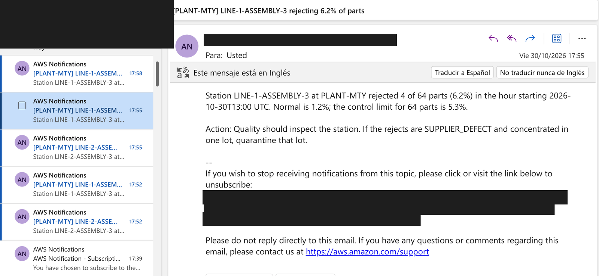
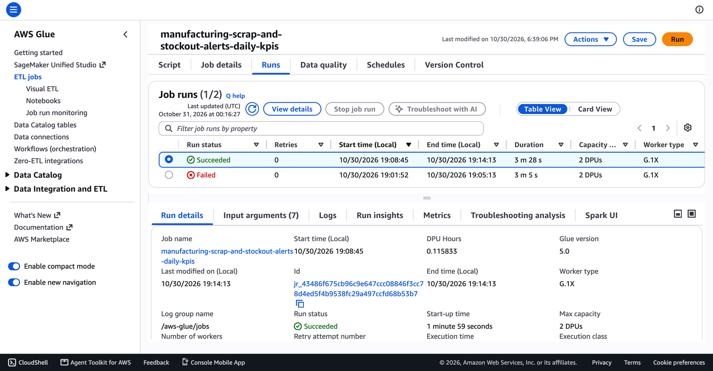
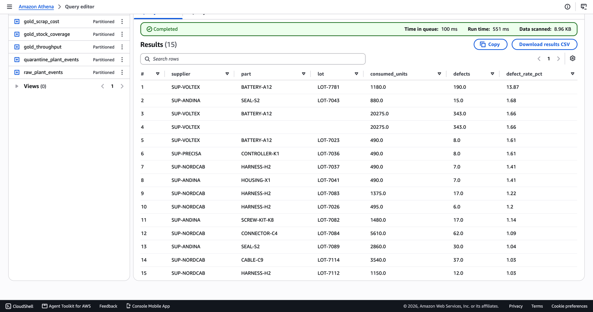

# Evidence: the real run on AWS

This project was deployed for real on **2026-10-30**: 41 AWS resources, 42 minutes, then destroyed and verified clean. It cost **$0.12**. Everything below comes from that run. Screenshots are cropped and redacted so no account id, email address or personal detail appears.

| What | Where |
|---|---|
| **Every screenshot, in the order of the process, with what each one proves** | [../project-story.md, level 7](../project-story.md#level-7--the-real-deploy) |
| Step-by-step record: timeline, results, what went differently, cost, teardown | [deploy-log.md](deploy-log.md) |
| Raw CLI output of every check (account id and emails replaced with placeholders) | [deployed/](deployed/) · [streamed/](streamed/) · [batch/](batch/) · [destroyed/](destroyed/) |
| All 22 console screenshots as files | [../images/console/](../images/console/) |
| Athena results, as CSV, and the charts drawn from them | [../images/results/](../images/results/) · [../images/](../images/) |

## The highlights

**Real-time alerts:** 1,011 live scans, 8 email alerts (exactly the predicted ones), 0 errors.

**The batch job failed first (an IAM permission only AWS could reveal), then succeeded** ([lesson 6](../lessons-learned.md)).

**One ROLLUP query on Athena, every level:** the defective lot at 13.87%.

