# How this project was built

The whole build, level by level: what each level added, why, what went wrong, and what it looks like running on AWS. Every level is a separate set of commits, so the history can be followed in `git log`.

| Level | What it added | Key commits |
|---|---|---|
| 0 | Business case, KPIs, design, cost estimate | `Add project spec…`, `Add design…` |
| 1 | Plant data generator with three planted incidents | `Add plant data generator…`, `Centralize every tunable value…` |
| 2 | Real-time alert rules (statistical process control) | `Add real-time alert logic…` |
| 3 | Exactly-once state in DynamoDB, SNS, the Lambda handler | `Add Lambda state, notifier and handler…` |
| 4 | Terraform for ingestion and the real-time path | `Add Terraform for ingestion…`, `Fix Terraform type errors…` |
| 5 | Firehose landing and the PySpark daily KPI job | `Add the PySpark daily KPI job…`, `Add Firehose landing…` |
| 6 | Athena tables, six ROLLUP queries, charts | `Add Athena catalog tables…`, `Add six KPI queries…` |
| 7 | Real deploy with evidence, fixes from it, teardown | `Prepare the deploy…`, and the commits after it |

---

## Level 0 · Business first

Before any code, `docs/spec.md` defined four things:
- the problem: scrap and stock-outs in an assembly plant;
- who acts on each number: Purchasing, Quality, the plant manager and the plant controller;
- four KPIs, each with a 3–4 level hierarchy (`docs/kpi-dictionary.md`);
- a **cost estimate under $1**.

The design (`docs/architecture.md`) uses three speeds over one stream of events:
- **seconds** for alerts;
- **about a minute** to keep every raw scan;
- **daily** for the KPIs.

## Level 1 · A plant that produces realistic, messy data

`src/generators/` simulates two plants, three lines each, 11 parts and 4 suppliers, hour by hour, with FIFO stock lots. Three incidents are planted so the pipeline has something real to find:

| Incident | What it looks like in the data |
|---|---|
| A defective supplier lot (LOT-7781, batteries) | Reject rate jumps on the stations that install it |
| A connector shortage in Monterrey | Extra usage plus missed deliveries: coverage drops below 1 day |
| LINE-3 behind on the night shift | ~11% of night batches don't run |

The scanners also misbehave:
- about 1% of scans are retries, sent again with the same `event_id`;
- about 0.1% are corrupted: a negative quantity, an unknown part or a missing plant.

All values live in `config/settings.yaml` and `config/master_data.yaml`.

## Level 2 · Alert rules that people won't learn to ignore

The first rule, "alert above 3% rejects in an hour", raised 22 alerts in a 3-hour session, and **14 of them were false**. It was replaced with a **p-chart control limit** that adapts to each station's volume. The result was **7 alerts, all real** (lesson 1, ADR-010).

## Level 3 · Exactly once, even when everything is retried

The Lambda writes each event in **one DynamoDB transaction**: it marks the `event_id` as seen, moves the stock and adds to the station's hourly counters.
- A retried scan cancels the whole transaction, so nothing is counted twice.
- Alerts are de-duplicated with a conditional write, so one problem sends one email.

Testing against a simulated AWS API (moto) caught a reserved-word bug before any deploy (lesson 2).

## Level 4 · Infrastructure as code

Terraform reads the same `config/settings.yaml` as the Python code. It creates:
- the stream;
- the Lambda with its event source mapping (partial failures, bisect on error, a dead-letter queue);
- the tables;
- the topic.

Each recipient gets an **email subscription with a filter policy**: Purchasing receives only stock alerts, and Quality Monterrey only Monterrey's rejects. `terraform validate` caught two type errors once the toolchain ran natively on Apple Silicon (lesson 3).

## Level 5 · The daily batch: clean, reconcile, then publish

Firehose keeps every scan in `raw/`. A Glue job (PySpark) runs these steps:
1. validates each record and quarantines the bad ones with a reason;
2. removes retries;
3. adds cost and planned usage;
4. builds one gold table per KPI, storing counts and never rates;
5. rebuilds the end-of-day stock from the opening stock.

**Before writing anything, it proves that `raw = curated + duplicates + quarantined` for every day.** That reconciliation test found a corrupted scan the rule-by-rule tests missed (lesson 4).

## Level 6 · Questions in SQL

Athena reads the lake through Glue Catalog tables with **partition projection** and a **1 GB scan cap**. Six queries answer six business questions. The KPI queries use `GROUP BY ROLLUP`, so one query returns every level of a hierarchy. The same SQL runs on local Spark, so it was tested before a single paid query (lesson 5).

---

## Level 7 · The real deploy

**41 resources created in 65 seconds, used for 42 minutes, then destroyed and verified.** The full record is `docs/evidence/deploy-log.md`. The screenshots below are from that session, cropped so no account details appear.

### The stream and the real-time Lambda

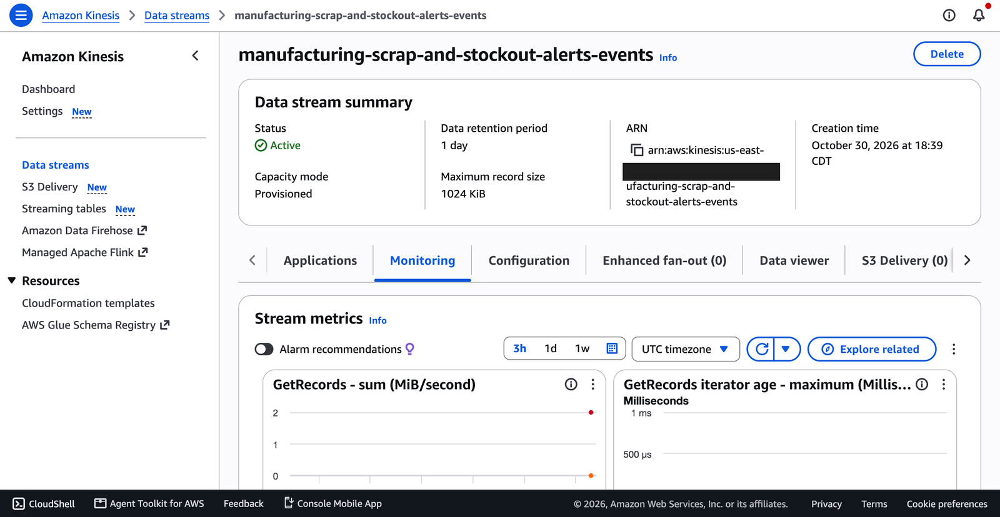
*The scanner stream: 1 shard, provisioned, 24 h retention.*

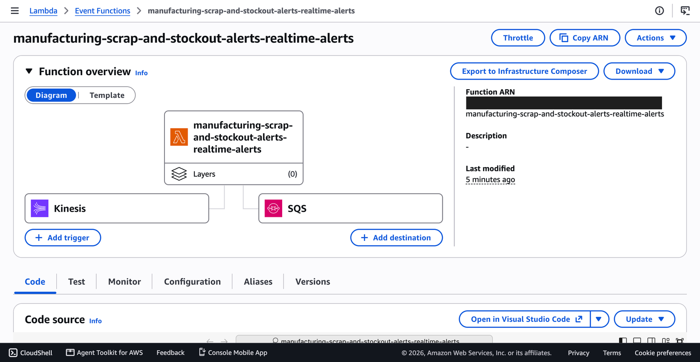
*The alert Lambda, triggered by Kinesis, with failed batches going to an SQS dead-letter queue.*

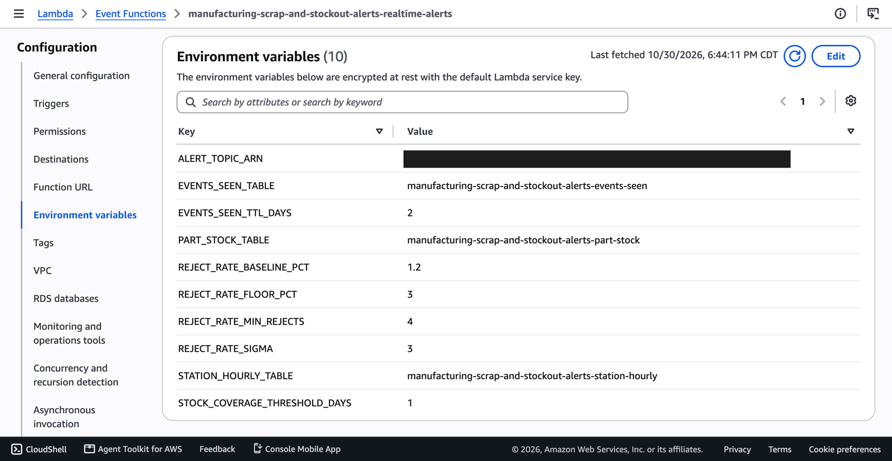
*Every threshold comes from `config/settings.yaml`, passed by Terraform as environment variables.*

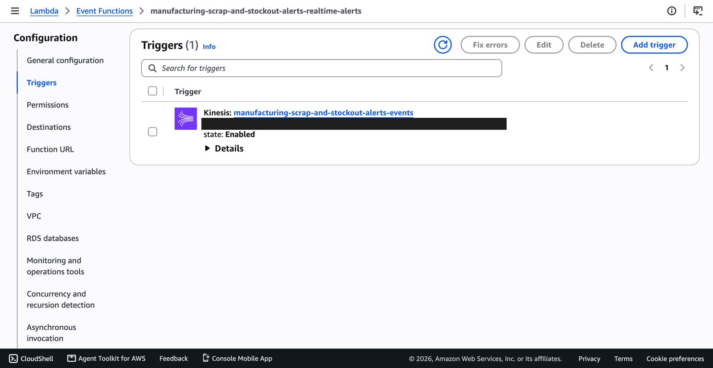 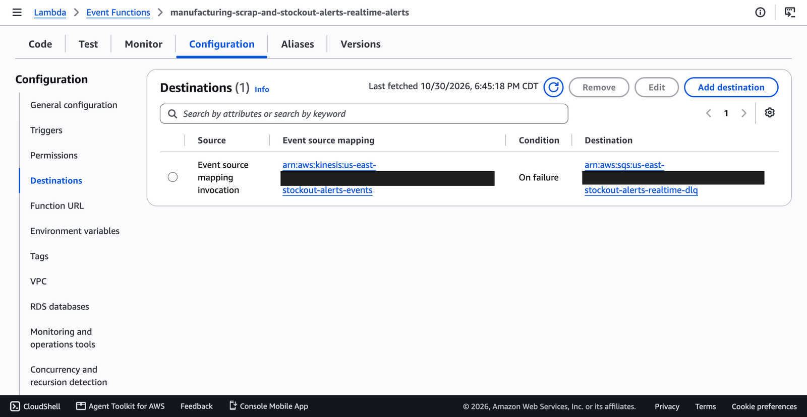
*The Kinesis trigger, and the on-failure destination: batches that still fail after every retry are parked, never lost.*

### State in DynamoDB

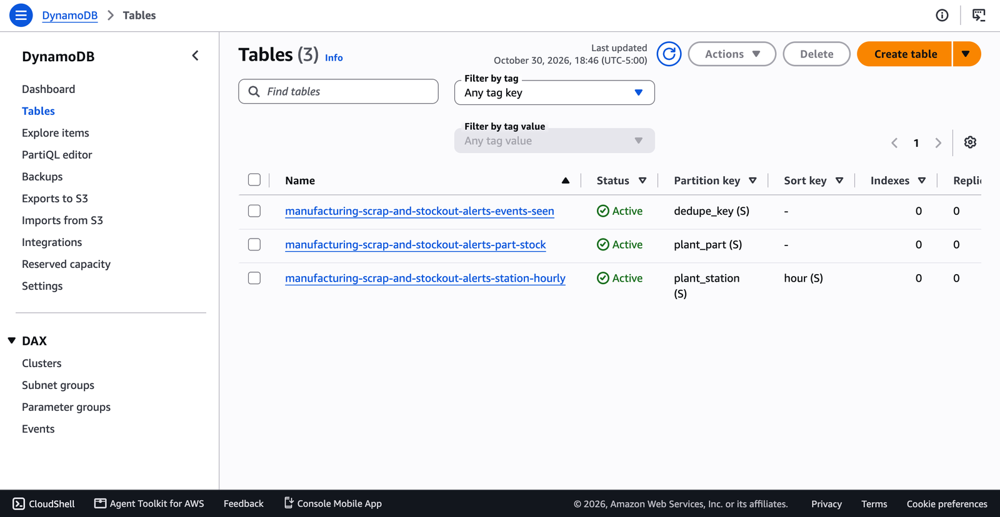
*The three tables: processed events (exactly once), live stock per plant and part, and hourly counters per station.*

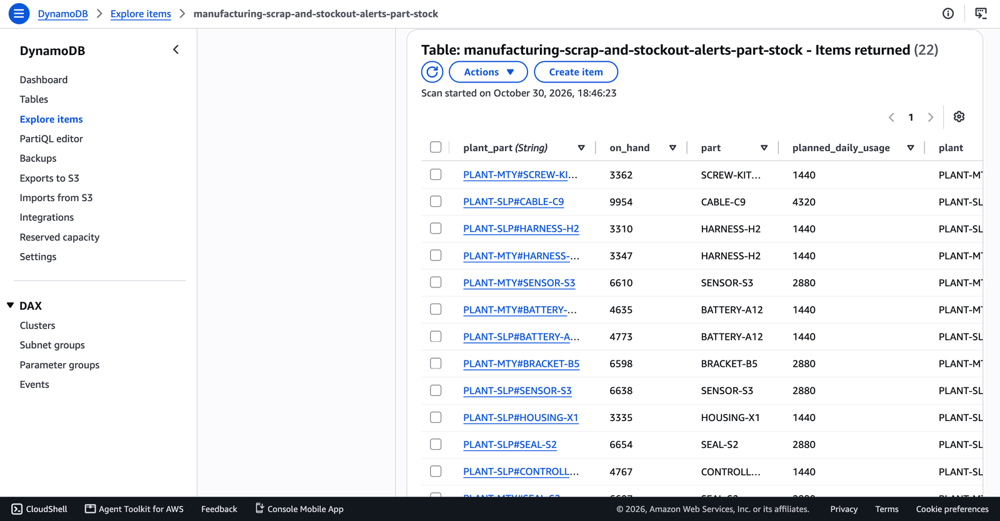
*The opening stock, seeded from the end of the 7-day history so the live session continues where the history stopped.*

### Alerts by email, to the right person

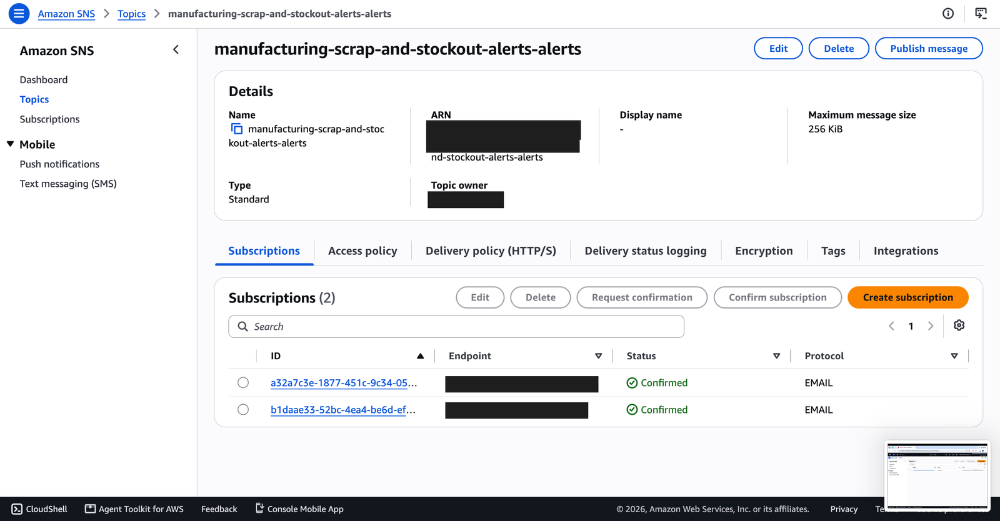
*Two confirmed email subscriptions, each with its own filter policy.*

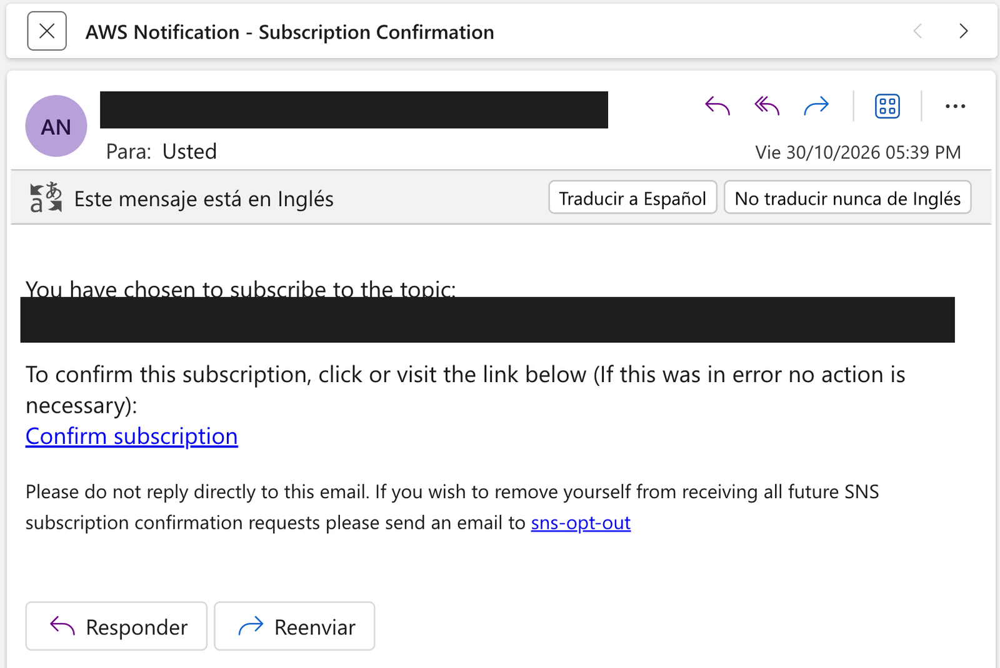
*Nothing is delivered until the recipient confirms. This email is that confirmation.*

*A real alert during the live session: a Monterrey station at 6.2% rejects against a control limit of 5.3%, with the action Quality should take.*

During the 10-minute live session:
- 1,011 events went through;
- the Lambda ran 104 times with 0 errors;
- it sent **exactly the 8 alerts the local tests predicted**: 1 low stock, 7 rejects, all on the stations using the defective lot.

### The lake in S3

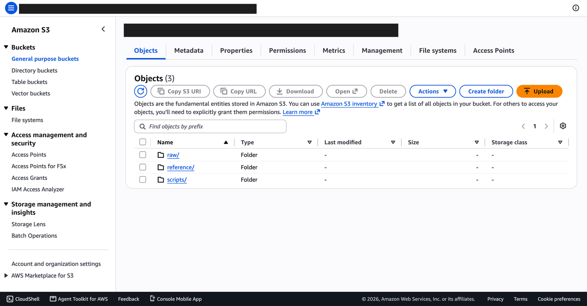
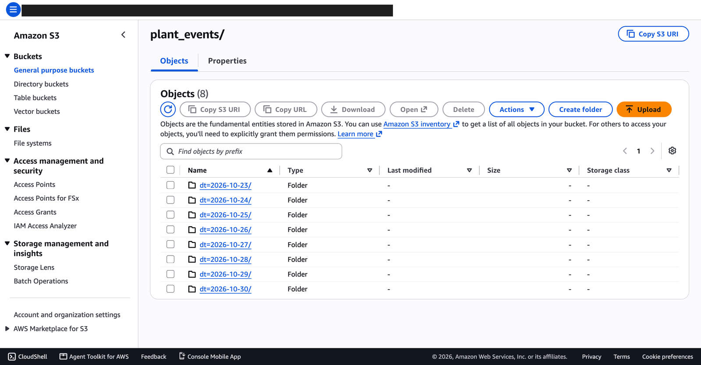
*`raw/plant_events/` partitioned by day: 8 history days, plus the live session that Firehose landed (9 files, all 1,011 records).*

### The batch job: it failed first, and that was useful

*Run 1 failed after 3 minutes: the Glue role could not write the `curated_$folder$` marker that Glue's S3 file system creates. It is a permission no local test can exercise. The policy was extended to exactly those objects, and run 2 succeeded in 3 min 28 s (lesson 6). Nothing half-written reached the lake, because the job writes only after the reconciliation passes.*

### Athena: one query, every level

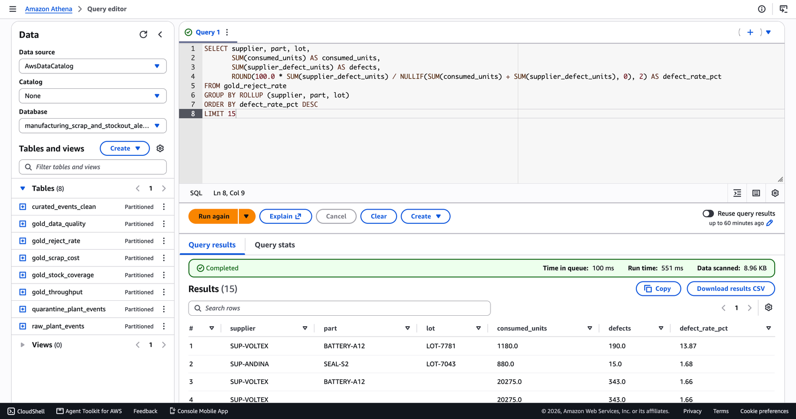

*Supplier → Part → Lot in one `GROUP BY ROLLUP`: LOT-7781 at **13.87%** supplier defects, while every other lot is below 1.7%. The query scanned 8.96 KB.*

### What the data showed

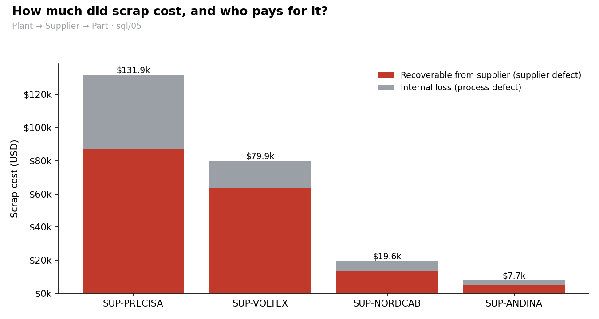

- **Quality:** one lot, LOT-7781, explains the reject spike. Quarantine it and claim it.
- **Purchasing:** CONNECTOR-C4 in Monterrey is at **0.89 days** of stock. Expedite.
- **Finance:** $239k of scrap, **71% recoverable** from suppliers. SUP-PRECISA costs the most in dollars ($131.9k) at normal defect rates, because its parts are expensive. The rate view and the dollar view point at different suppliers, and both are right.

### A wrong number, caught by looking at the results

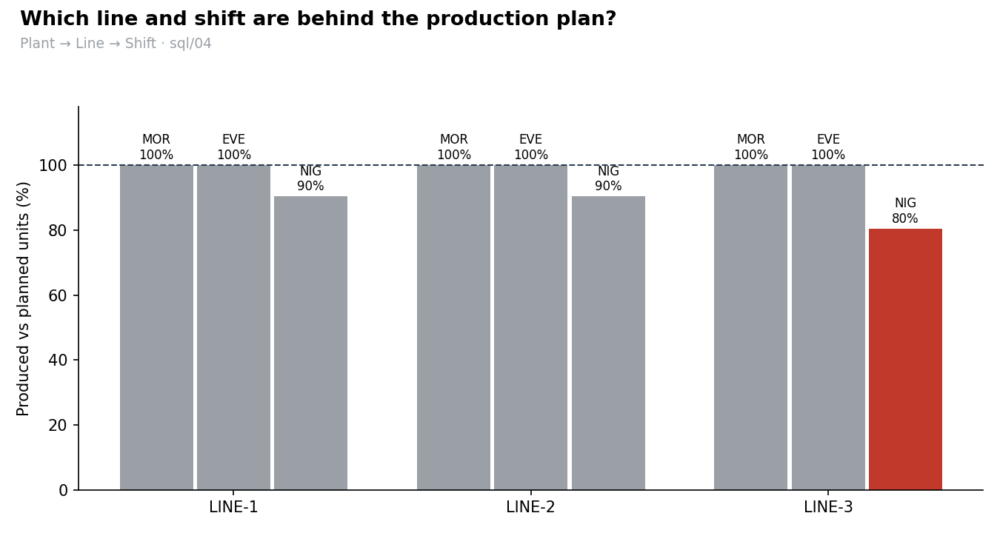
*The real Athena output: every night shift ~10% behind plan. Wrong.*

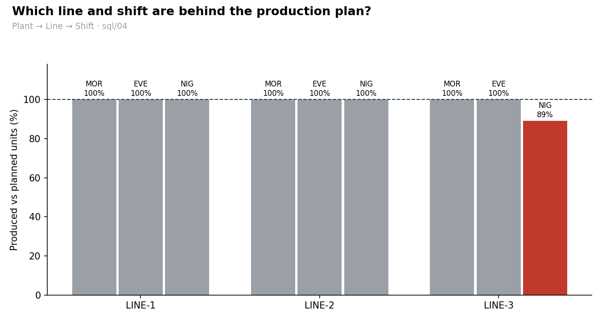
*The same data after the fix: only LINE-3's night shift is behind (89.1%), the planted incident.*

The 6 hours between the end of the history and the start of the live session had no scans at all, and the rule counted them as "zero produced". Now an hour is compared with the plan only if the plant sent data in that hour (lesson 7). A scanner outage in a real plant would have produced the same false shortfall.

### Teardown

`terraform destroy` removed all 41 resources. `make clean-glue-logs` removed the log groups Glue had created by itself. Then `make leftovers` checked three independent nets and reported **✅ Nothing billable left.**:
- the `Project` tag;
- 13 resource types by name;
- 11 services that bill by the hour.

Proof: `docs/evidence/destroyed/`.
